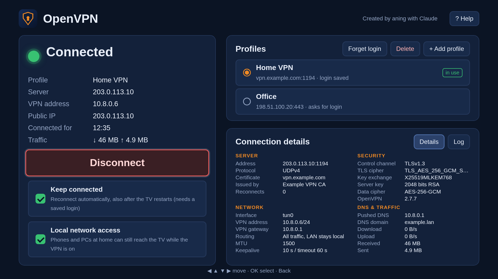
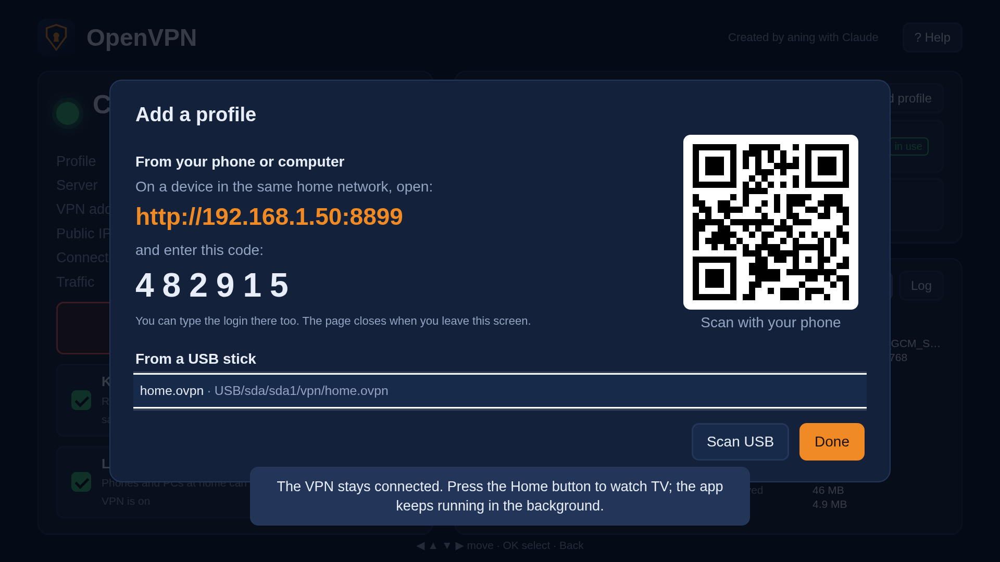
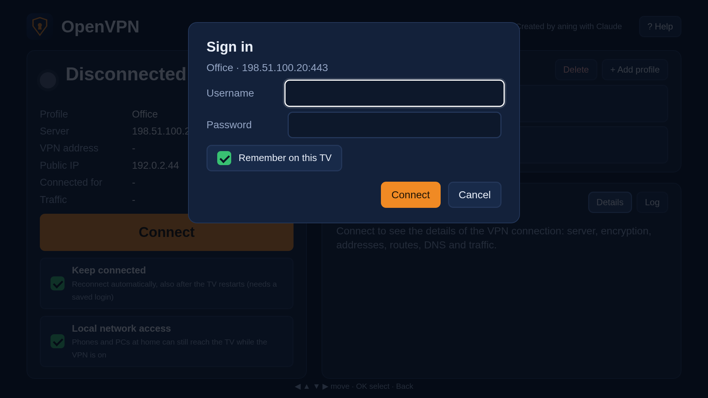

# OpenVPN for webOS

An OpenVPN client for **rooted LG webOS TVs**. Load your own `.ovpn` profile, connect with one button, and keep the
TV on your VPN while you watch: it stays connected in the background, reconnects after drops and comes back after the
TV restarts.

Created by aning with Claude.



## Features

- **Your own profile.** Nothing is built in: add your `.ovpn` file from your phone or computer (scan the QR code on the
  TV) or from a USB stick. Several profiles can be kept and switched.
- **One-button connect** with the Magic Remote or arrow keys. Login prompt on the TV, or type it on your phone while
  uploading the profile. *Remember on this TV* stores it (root-only file on the TV), and only after the server accepted it.
- **Stays connected.** The VPN runs on its own, outside the app. Press **Home** to watch TV; Back does not close the app
  while connected. *Keep connected* reconnects if the connection drops and after the TV restarts.
- **Local network access** (on by default): phones and PCs at home, even on another subnet, can still reach the TV
  (casting, remote apps, SSH) while the VPN carries all other traffic.
- **Connection details:** server, protocol, server certificate, TLS version and cipher, key exchange, data cipher, tunnel
  interface, VPN address and gateway, routing mode, MTU, keepalive, DNS pushed by the server, live download/upload
  speed, traffic totals, public IP and reconnect count, plus the OpenVPN log.
- **Safe profiles.** OpenVPN runs as root, so every imported profile is cleaned: scripts (`up`, `down`, ...), plugins,
  OpenSSL engines/providers and file-writing options are removed, and openvpn always runs with `--script-security 1`.
- OpenVPN 2.7 (OpenSSL 3) from Alpine Linux, bundled; nothing on the TV is modified.

## Requirements

- An LG webOS TV that is **rooted** and has **Homebrew Channel** installed. A VPN changes the TV's network routes, which
  needs root. (Tested on a 50UR7550, webOS 10.3.1.)
- A **single-file** `.ovpn` profile: certificates and keys inline (`<ca>`, `<cert>`, `<key>`, `<tls-auth>` / `<tls-crypt>`
  blocks). Most VPN providers and pfSense/OPNsense "inline configuration" exports are like this.

## Install

**Homebrew Channel (recommended):** open Homebrew Channel → Settings → *Add repository* and enter

```
https://raw.githubusercontent.com/aningako/openvpn-webos/main/repo/apps.json
```

then install **OpenVPN** from the list. Updates show up there too.

**Manually:** download `com.homebrew.openvpn_<version>_all.ipk` from
[Releases](https://github.com/aningako/openvpn-webos/releases) and install it with Homebrew Channel or `ares-install`.

The first time you open the app it asks Homebrew Channel for root access for its service ("Setting up…"); this happens
once.

## How to use

### 1. Add your profile

1. Open **OpenVPN** on the TV and choose **+ Add profile**.
2. The TV shows an address such as `http://192.168.1.50:8899`, a **6-digit code** and a QR code.
3. On a phone or computer **in the same home network**, scan the QR code or type the address in a browser.
4. Enter the code, pick your `.ovpn` file and (optional) a name. You can type the VPN **username and password** here as
   well, so you don't have to type them with the remote.
5. Press **Send to TV**. The profile appears in the list right away. Leave the screen with **Done** or Back; the upload
   page closes with it.

**From a USB stick:** copy the `.ovpn` file to a USB stick, plug it into the TV, choose **+ Add profile → Scan USB** and
select the file.

If the TV says it removed something "for safety", the profile contained scripts or plugins; the VPN works without them on
a TV. If it says the profile "uses a separate file", export it again as a single file with the certificates inside.



### 2. Connect

1. Select the profile (it gets the orange dot) and press **Connect**.
2. If the profile needs a login and none is saved, the TV asks for it. Keep **Remember on this TV** ticked to save it
   (needed for automatic reconnects).
3. The status turns green: **Connected**. The card shows your VPN address and public IP.

If the login is wrong, the TV says so and asks again; a wrong login is never saved.



### 3. Watch TV while connected

Press the **Home** button and open any app. The VPN keeps running in the background, for the whole TV. Back does not close
the app while connected (it tells you to use Home), so the connection can't be dropped by accident. Open OpenVPN again
at any time to see the status.

### 4. Options

- **Keep connected** (on by default): if the connection drops or the TV restarts, it reconnects the selected profile with
  the saved login. Pressing **Disconnect** turns this off until you connect again.
- **Local network access** (on by default): your home devices can still reach the TV while the VPN is on. Turn it off only
  if you want *all* traffic, including to your home network, to go through the VPN. Changes apply on the next connect.

### 5. Connection details and log

The **Connection details** card shows everything about the active connection: server and protocol, the server's
certificate, encryption (TLS version, cipher, key exchange, data cipher), the tunnel interface, VPN address and
gateway, whether all traffic or only some networks use the VPN, MTU, keepalive, DNS servers pushed by the server, live
speed and traffic. Switch to **Log** to see OpenVPN's own messages when something doesn't work.

### 6. Manage profiles

- **Forget login** removes the saved username/password of the selected profile.
- **Delete** removes the selected profile and its login from the TV (disconnect first).
- **? Help** shows a short version of this guide on the TV.

## Notes and limits

- **DNS:** the TV keeps using its own DNS (normally your router); DNS servers pushed by the VPN are shown but not applied.
  With *Local network access* on, DNS queries to your router stay local.
- IPv4 is fully supported; IPv6 routes are passed to OpenVPN as-is.
- Profiles that need extra files, smart cards (PKCS#11), or a challenge/OTP login are not supported yet.
- Profiles and saved logins are stored in `/home/root/.config/com.homebrew.openvpn` (root-only). Uninstalling the app does
  not delete them; remove that folder to wipe them.
- The upload page is plain HTTP on your home network and is only open while the *Add profile* screen is shown, protected
  by the one-time code (5 wrong codes close it).

## Troubleshooting

| Problem | What to do |
| --- | --- |
| "Rooted TV needed" | The TV isn't rooted or Homebrew Channel is missing. The app can't work without root. |
| Stuck on "Connecting…" | Open **Log**. "TLS handshake failed" or timeouts mean the server can't be reached on that port (firewall, wrong address). |
| "Wrong username or password" | Enter the login again; check it in your VPN provider's dashboard. |
| Phone/PC can't reach the TV while connected | Turn on **Local network access**, then disconnect and connect again. |

## Build from source

```sh
python3 scripts/fetch_openvpn.py   # downloads OpenVPN + libraries from Alpine Linux (armv7), checksum-verified
python3 scripts/make_icons.py      # optional: redraws the icons
python3 scripts/build_ipk.py       # -> releases/com.homebrew.openvpn_<version>_all.ipk
python3 scripts/make_repo.py       # Homebrew Channel repo files for the release
```

Tests without a TV:

```sh
node tools/test/sanitize_test.js   # profile sanitizer + connection-details parser
python3 tools/demo/shoot.py docs   # UI in headless Chromium with a mock service (also makes these screenshots)
```

`TV=<tv-ip> scripts/install_tv.sh` installs a build on a rooted TV over SSH (root SSH via Homebrew Channel).

### How it works

- `app/com.homebrew.openvpn` is the TV app (HTML/JS). It talks to the service over the webOS luna bus.
- `service/com.homebrew.openvpn.service` is a Node.js service that Homebrew Channel elevates to root. It starts
  `openvpn` detached (so the VPN outlives the app and the service) and controls it through OpenVPN's management socket.
  The login is passed over that socket, never written to a temp file.
- `watchdog.sh` is started by the service and, at boot, by Homebrew Channel (`/var/lib/webosbrew/init.d`). Every 20 s it
  asks the service to reconnect if *Keep connected* is on, the user didn't press Disconnect, and openvpn isn't running.

## License

MIT for this project's code (see [LICENSE](LICENSE)). The bundled OpenVPN and libraries keep their own licenses (OpenVPN
is GPL-2.0); see [THIRD_PARTY.md](THIRD_PARTY.md) for sources. OpenVPN is a registered trademark of OpenVPN Inc.; this
project is not affiliated with OpenVPN Inc.
